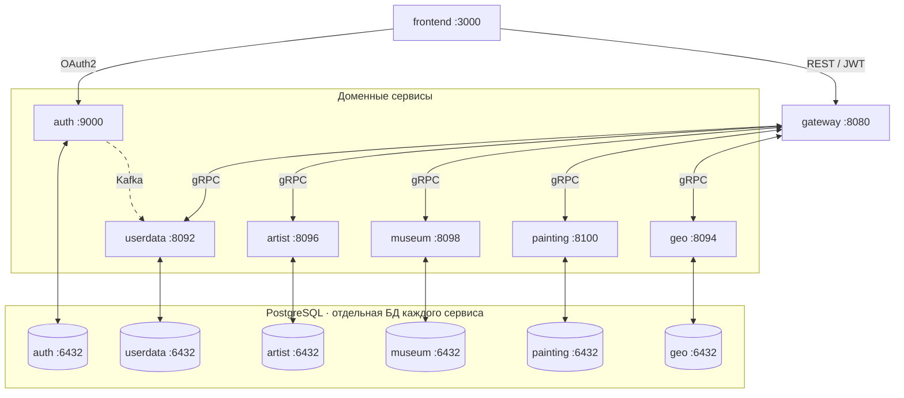
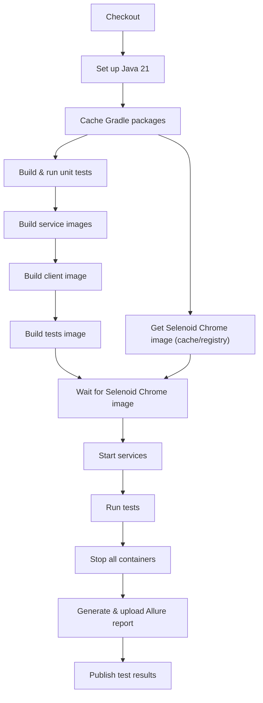

# Rococo

> Каталог искусства: картины, художники и музеи в одном приложении.

Rococo — учебный микросервисный проект с веб-интерфейсом и автоматизированными проверками
на уровнях unit, gRPC, REST и UI. Просматривайте коллекцию, добавляйте и редактируйте
экспонаты, управляйте профилем пользователя.

**Java 21 · Spring Boot 3 · SvelteKit · gRPC · Kafka · PostgreSQL**

[Архитектура](#архитектура) · [Тестирование](#тестирование) · [Локальный запуск](#локальный-запуск) · [Запуск в Docker](#запуск-в-docker) · [Workflow CI](#workflow-ci-) · [Отчёты](#отчёты) · [Решение проблем](#решение-проблем)

## Возможности

| Раздел    | Что можно делать                                                                                |
|-----------|-------------------------------------------------------------------------------------------------|
| Картины   | Смотреть каталог и карточки, создавать и редактировать картины со ссылками на художника и музей |
| Художники | Смотреть каталог и биографии, добавлять и редактировать художников                              |
| Музеи     | Смотреть каталог, добавлять и редактировать музеи с городом и страной                           |
| Профиль   | Регистрироваться, входить, изменять имя и аватар                                                |

Чтение каталога доступно без авторизации. Создание и редактирование требуют JWT.

## Архитектура

Frontend обращается к gateway по REST. Gateway проверяет JWT, вызывает доменные сервисы по gRPC
и собирает связанные данные в ответ. Регистрация передаётся из auth в userdata через Kafka.



### Карта модулей

| Модуль                                                  | Ответственность                               | Интерфейс   |
|---------------------------------------------------------|-----------------------------------------------|-------------|
| [rococo-client](rococo-client)                          | Веб-интерфейс на SvelteKit                    | HTTP `3000` |
| [rococo-auth](rococo-auth)                              | OAuth2, регистрация, JWT, события регистрации | HTTP `9000` |
| [rococo-gateway](rococo-gateway)                        | REST API, проверка ссылок, обогащение ответов | HTTP `8080` |
| [rococo-userdata](rococo-userdata)                      | Профили пользователей                         | gRPC `8092` |
| [rococo-geo](rococo-geo)                                | Справочник стран с кешированием               | gRPC `8094` |
| [rococo-artist](rococo-artist)                          | Художники                                     | gRPC `8096` |
| [rococo-museum](rococo-museum)                          | Музеи                                         | gRPC `8098` |
| [rococo-painting](rococo-painting)                      | Картины                                       | gRPC `8100` |
| [rococo-grpc-common](rococo-grpc-common/src/main/proto) | Protobuf-контракты и генерируемые Java stubs  |             |
| [rococo-common](rococo-common)                          | Общий код backend-сервисов                    |             |
| [rococo-tests](rococo-tests)                            | Интеграционные и UI-тесты                     |             |

### Границы данных

- Auth и пять доменных сервисов владеют отдельными БД и миграциями Flyway; у gateway нет БД. Межсервисных внешних ключей нет.
- Доменные сервисы возвращают собственные данные. Gateway проверяет существование связанных сущностей через batch RPC.
- При загрузке картин gateway параллельно получает художников и музеи.
- Фотографии и изображения хранятся в PostgreSQL как `BYTEA`, передаются по gRPC в base64.
- Ошибки gRPC преобразуются в HTTP: `NOT_FOUND` — `404`, `ALREADY_EXISTS` — `409`, `INVALID_ARGUMENT` — `400`, `INTERNAL` — `500`.

## Тестирование

Бизнес-правила проверяются изолированно, контракты и сохранение данных — через API,
пользовательские сценарии — через браузер. Тестовые данные генерируются для отдельных сценариев.

| Уровень | Проверки                                                                         | Окружение                                   | Исходники                                                              |
|---------|----------------------------------------------------------------------------------|---------------------------------------------|------------------------------------------------------------------------|
| Unit    | Валидация, бизнес-правила, преобразования, ошибки; зависимости подменены Mockito | JVM                                         | `rococo-*/src/test/java`, кроме `rococo-tests`                         |
| gRPC    | CRUD, пагинация, статусы, соответствие данных в БД                               | Backend, PostgreSQL, Kafka                  | [api/grpc](rococo-tests/src/test/java/io/efremov/rococo/test/api/grpc) |
| REST    | OAuth2, HTTP-статусы, ссылки и составные ответы gateway                          | Backend с auth и gateway, PostgreSQL, Kafka | [api/rest](rococo-tests/src/test/java/io/efremov/rococo/test/api/rest) |
| UI      | Просмотр, создание и редактирование сущностей, профиль                           | Полный стек и Chrome; в Docker — Selenoid   | [ui](rococo-tests/src/test/java/io/efremov/rococo/test/ui)             |

gRPC-тесты вызывают доменные сервисы напрямую. Авторизация и проверка межсервисных ссылок тестируются через REST gateway.
Стек проверок: **JUnit 5 · Mockito · AssertJ · Retrofit · Selenide · Selenoid · Allure · Instancio**.

## Локальный запуск

Инфраструктура работает в Docker, Java-сервисы и frontend — на хосте.
Все команды выполняются из корня репозитория.

### 1. Подготовьте окружение

Нужны **JDK 21**, **Node.js 20 с npm** и **Docker с Compose**. Gradle запускается через wrapper из репозитория.
Для локальных UI-тестов нужен установленный Chrome.

Примеры используют Bash. В PowerShell заменяйте `./gradlew` на `.\gradlew.bat`.

```bash
# запуск Postgres и Kafka
docker compose --profile env up -d

# установка зависимостей frontend
npm --prefix rococo-client ci

# запуск frontend (оставьте терминал открытым)
npm --prefix rococo-client run dev
```

### 2. Запустите backend

Каждую команду выполняйте в отдельном терминале. Также можно запускать приложения через профили IDE.

```bash
./gradlew :rococo-auth:bootRun
./gradlew :rococo-geo:bootRun
./gradlew :rococo-artist:bootRun
./gradlew :rococo-museum:bootRun
./gradlew :rococo-painting:bootRun
./gradlew :rococo-userdata:bootRun
./gradlew :rococo-gateway:bootRun
```

### 3. Откройте Rococo

Откройте [Rococo на localhost:3000](http://localhost:3000/).
Перейдите в каталог картин, художников или музеев. Зарегистрируйтесь для создания и редактирования записей.

### 4. Запустите тесты

#### Unit-тесты

```bash
# Unit-тесты одного сервиса
./gradlew :rococo-artist:test

# Unit-тесты всех модулей без интеграционных и UI-тестов rococo-tests
./gradlew test -x :rococo-tests:test
```

#### API и UI

Сначала поднимите окружение по инструкции локального запуска.

```bash
# Интеграционные API-тесты
./gradlew :rococo-tests:testApi

# E2E в локальном Chrome
./gradlew :rococo-tests:testUi

# Все тесты модуля rococo-tests
./gradlew :rococo-tests:test --no-daemon
```

Задачи `testMutationApi`, `testInfoApi` и `testUi` выбирают JUnit-теги `mutation`, `info` и `ui`.
Обе API-группы включают REST и gRPC; методы mutation-тестов выполняются последовательно.
Задача `:rococo-tests:test` запускает все тесты модуля, включая UI, поэтому общие `./gradlew test` и `./gradlew build` тоже требуют полного
окружения.

#### Параметризация окружения

Окружение выбирается системным свойством `test.env`: без него используется локальная конфигурация,
с `-Dtest.env=docker` — Docker-конфигурация:

- для локального запуска используется [LocalConfig](rococo-tests/src/test/java/io/efremov/rococo/config/LocalConfig.java)
- для запуска в среде Docker используется [DockerConfig](rococo-tests/src/test/java/io/efremov/rococo/config/DockerConfig.java).

## Запуск в Docker

### 1. Соберите образы

Нужны JDK 21 и запущенный Docker с Compose. Команды выполняются из корня репозитория;
примеры используют Bash, для Gradle в PowerShell используйте `.\gradlew.bat`.
Соберите семь Java-сервисов, frontend и тестовый модуль:

```bash
./gradlew dockerBuildAll
docker build -f rococo-client/Dockerfile -t rococo-client:latest rococo-client
./gradlew :rococo-tests:build -x test
docker build -f rococo-tests/Dockerfile -t rococo-tests:latest .
```

Альтернатива — `bash docker-build.sh`. Скрипт [docker-build.sh](docker-build.sh) перед сборкой удаляет контейнеры с `rococo` в имени
и образы с префиксом `rococo`.

### 2. Настройте имена хостов

Для доступа к Docker-окружению из браузера добавьте записи в `/etc/hosts` (Linux/macOS)
или `C:\Windows\System32\drivers\etc\hosts` (Windows, нужны права администратора):

```
127.0.0.1 	rococo-client
127.0.0.1 	rococo-auth
127.0.0.1 	rococo-gateway
127.0.0.1 	rococo-artist
127.0.0.1 	rococo-geo
127.0.0.1 	rococo-museum
127.0.0.1 	rococo-painting
127.0.0.1 	rococo-userdata
```

### 3. Запустите приложение и тесты

Перед запуском UI-тестов загрузите образ Chrome в тот же Docker daemon, который использует Selenoid:

```bash
docker pull twilio/selenoid:chrome_stable_147
```

Запустите приложение без тестов:

```bash
docker compose --profile env --profile modules up -d
```

Приложение доступно по адресу [http://rococo-client:3000](http://rococo-client:3000/).
Затем запустите API- и UI-тесты в контейнере с возвратом их кода завершения:

```bash
docker compose --profile env --profile modules --profile tests up --exit-code-from rococo-tests
```

Тестовый контейнер выполняет `testApi` и `testUi` с `--continue` и `-Dtest.env=docker`.
Для остановки окружения после тестов:

```bash
docker compose --profile env --profile modules --profile tests down
```

Именованный volume PostgreSQL сохраняется при `down`.

Настройки сервисов, health checks и профилей находятся в [docker-compose.yml](docker-compose.yml).

## Workflow CI

[Workflow CI](.github/workflows/ci.yml) запускается при push в любую ветку, при открытии
и обновлении pull request, а также вручную через **Actions → CI → Run workflow**.
Job `Rococo CI` работает на `ubuntu-latest` с Java 21 Temurin.



## Отчёты

| Результат                       | Расположение                                                                                                                              |
|---------------------------------|-------------------------------------------------------------------------------------------------------------------------------------------|
| Allure в CI                     | Артефакт `report.zip` на странице запуска; хранится 14 дней                                                                               |
| Сводка CI                       | Job Summary: счётчики unit-, API- и UI-тестов и ссылка на отчёт                                                                           |
| Pull request                    | Комментарий с результатами проверок (только для события `pull_request`, при наличии прав записи)                                          |
| JUnit XML и HTML локально       | [rococo-tests/build/test-results](rococo-tests/build/test-results) и [rococo-tests/build/reports/tests](rococo-tests/build/reports/tests) |
| Allure после локального запуска | [rococo-tests/build/allure-report](rococo-tests/build/allure-report)                                                                      |
| Allure после Docker-запуска     | [allure-report](allure-report)                                                                                                            |

Для генерации отчёта установите [Allure Commandline](https://allurereport.org/docs/v2/install-for-nodejs):

```bash
# После локальных тестов
allure generate rococo-tests/build/allure-results --single-file --clean

# После Docker-тестов
allure generate allure-results --single-file --clean
```

Откройте `allure-report/index.html`. Для CI скачайте артефакт `report.zip`, распакуйте его и откройте `index.html`.

## Решение проблем

| Симптом                                                                          | Что проверить                                                                                                                                                                  |
|----------------------------------------------------------------------------------|--------------------------------------------------------------------------------------------------------------------------------------------------------------------------------|
| Порт занят                                                                       | [free-ports.sh](free-ports.sh) или [free-ports.ps1](free-ports.ps1) завершают процессы на портах приложения; перед запуском проверьте список в скрипте                         |
| Windows не даёт занять gRPC-порты                                                | Docker/Hyper-V может резервировать диапазон `7995–8194`. В PowerShell администратора выполните `net stop winnat`, затем `net start winnat`                                     |
| `SessionNotCreatedException`: `No such image: twilio/selenoid:chrome_stable_XXX` | Загрузите образ в Docker daemon, который использует Selenoid: `docker pull twilio/selenoid:chrome_stable_XXX`                                                                  |
| Версия браузера в Docker не совпадает                                            | Согласуйте версию в [BrowserExtension](rococo-tests/src/test/java/io/efremov/rococo/jupiter/extension/BrowserExtension.java) и образ в [browsers.json](selenoid/browsers.json) |
| Не открываются имена `rococo-*`                                                  | Проверьте записи hosts и опубликованные порты Compose                                                                                                                          |
| Команда `allure` не найдена                                                      | Установите [Allure Commandline](https://allurereport.org/docs/v2/install-for-nodejs)                                                                                           |
